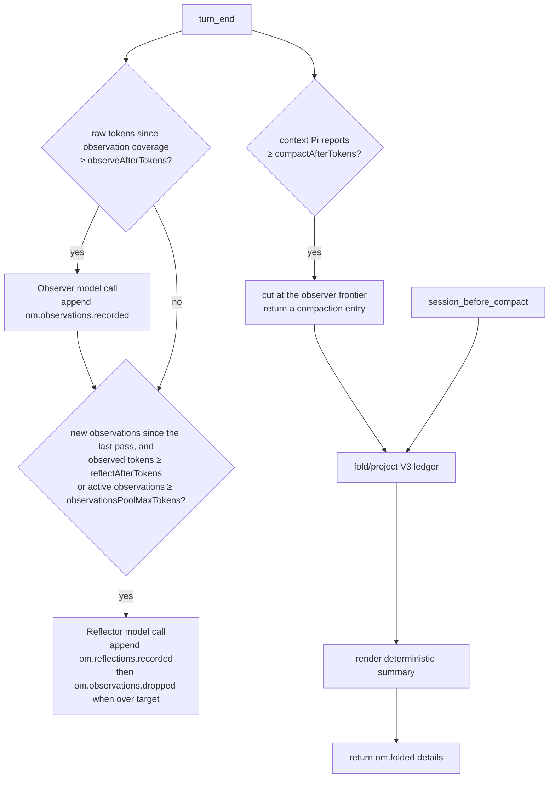

# How it works

This is the V3 technical reference for `pi-observational-memory`.

V3 is ledger-centered: memory state is reconstructed by folding V3 ledger entries on the current branch. When that projection is non-empty, V3 renders it model-free into the summary the agent sees. Pi's native summarizer never runs: a compaction the memory cannot cover is postponed.

## Runtime entry points

`src/index.ts` registers one shared runtime and these Pi surfaces:

| Surface | Purpose |
|---|---|
| `turn_end` observer trigger | Maybe run the observer in the background. |
| `turn_end` reflector trigger | After the observer, run the reflector every `reflectAfterTokens` of observed source, or earlier when the active observation pool reached `observationsPoolMaxTokens`: it records reflections and, while the pool is over `observationsPoolTargetTokens`, drops observations toward it. |
| `turn_end` memory activation | Return a compaction entry when the context Pi reports reaches `compactAfterTokens`; runs before the worker triggers. |
| `session_before_compact` hook | Build the V3 compaction payload deterministically. |
| `/om:status` | Show ledger counts, drift, progress clocks, and worker state. |
| `/om:view` | Show visible or full memory content and attempt to copy the rendered memory text. |
| `/om:log` | List what the memory workers added and dropped on the branch. |
| `session_start` / `session_tree` | Rewrite the memory file for the resumed or navigated branch when `memoryFile` is on. |
| `recall` tool | Recover source evidence for a memory id. |

## Lifecycle overview



One consolidation pass runs the observer when it is due, then re-reads the branch and runs the reflector when it is due, so a new observer chunk can make the reflector due in the same pass. An observer failure ends the pass.

## Source entries and progress

V3 raw-token progress counts only source entries:

- `message`
- `custom_message`
- `branch_summary`

Memory ledger entries and compaction entries do not add raw-token progress.

Every V3 ledger entry has `data.coversUpToId`. That field is a progress and projection watermark. The observer clock counts raw/source tokens after the latest valid watermark:

| Worker/trigger | Progress source |
|---|---|
| Observer | latest `om.observations.recorded.data.coversUpToId` |
| Reflector | latest `om.reflections.recorded` / `om.observations.dropped` coverage, whichever reaches further, counted up to the latest observation coverage; the active observation pool size also makes it due |
| Activation | latest compaction boundary |

The watermark is also used to decide whether a memory ledger entry belongs to a bounded projection. It is not provenance. Provenance lives in `sourceEntryIds` and `supportingObservationIds`.

## Ledger data shapes

### Observations recorded

```ts
customType: "om.observations.recorded"
data: {
  observations: Observation[];
  coversUpToId: string;
}
```

Each observation:

```ts
type Observation = {
  id: string;
  content: string;
  timestamp: string;
  relevance: "low" | "medium" | "high" | "critical";
  sourceEntryIds: string[];
  tokenCount: number;
}
```

The builder rejects empty observation arrays, so no empty progress entries are written.

### Reflections recorded

```ts
customType: "om.reflections.recorded"
data: {
  reflections: Reflection[];
  coversUpToId: string;
}
```

Each reflection:

```ts
type Reflection = {
  id: string;
  content: string;
  supportingObservationIds: string[];
  tokenCount: number;
}
```

The reflector must cite valid active observation ids.

### Observations dropped

```ts
customType: "om.observations.dropped"
data: {
  observationIds: string[];
  coversUpToId: string;
}
```

Drops are tombstones. They remove ids from active observations but do not delete ledger history.

### Folded compaction details

```ts
details: {
  type: "om.folded";
  version: 1;
  fullFold: boolean;
  observations: Observation[];
  reflections: Reflection[];
}
```

These details are what later visible projections read. The ledger remains the source of truth.

## Memory changes

Every worker writes the ledger through `recordMemoryEntry` (`src/memory-journal.ts`): it appends the entry, then derives the change from the branch with `memoryChangelog` (`src/session-ledger/changelog.ts`). With `showWorkerNotifications`, it notifies the change and a preview of the first three records. With `memoryFile`, it rewrites the session's memory file with the current memory. `/om:log` renders the changelog.

## Observer flow

The observer trigger runs on `turn_end`.

1. Load config if needed.
2. Skip if `passive` is true.
3. Skip if `observerInFlight` is true.
4. Count raw/source tokens since latest observation coverage.
5. Skip if below `observeAfterTokens`.
6. Honor any deliberate-empty backoff until another `observeAfterTokens` of source tokens arrive.
7. Select the oldest size-capped chunk after the latest observation coverage marker.
8. Serialize those source entries for the observer prompt.
9. Resolve the memory model.
10. Run `runObserver()` in a background task.
11. Validate source ids returned by the model.
12. Compute deterministic 12-character ids and per-observation token counts in code.
13. Append `om.observations.recorded` only if at least one observation was accepted.

If no observations are generated, the worker writes no entry and does not advance coverage. A later eligible observer run will see a larger range. Deliberate empty runs back off until another `observeAfterTokens` worth of new source tokens arrives, so they do not re-fire every turn. Observer chunks target a fixed 60,000 estimated tokens, oldest-first, so an oversized uncovered span drains in slices; the oldest entry is always included even if it alone exceeds the target, preventing coverage from stalling. API/stream failures surface as `observer failed` / `observer.stream_error` rather than as an empty run.

## Reflector flow

The reflector runs in the same consolidation pass as the observer, after it.

1. Re-read the branch and fold current ledger state.
2. Skip unless observation coverage moved past the coverage of the latest reflector pass. A pass that leaves the pool over its limit therefore waits for the observer to record more.
3. Skip while a pass on this session changed nothing and fewer than `reflectAfterTokens` more observed tokens arrived since.
4. Skip unless the observed source since the latest pass reached `reflectAfterTokens` (the larger of the raw estimate and the provider context delta), or the active observation pool, counted as the lines the reflector sees, reached `observationsPoolMaxTokens`.
5. Resolve the memory model and run `runReflector()` with the oldest observations that fit the worker memory budget. Each observation line carries its reflection coverage (`none`, `partial`, or `strong`).
6. The model records reflections with `record_reflections`. Only while the pool is over `observationsPoolTargetTokens` does it get `drop_observations` and the drop rules, and it proposes drops after its reflections. The receipt of `record_reflections` lists the observations the new reflections support, and coverage counts the new reflections too.
7. Code keeps valid one-line reflections whose support ids are active observations, and at most `maxDropsAllowed` known drop ids, preferring stronger coverage, then lower relevance, then older observations. `maxDropsAllowed` converts the tokens over `observationsPoolTargetTokens` to an approximate observation count.
8. Append non-empty `om.reflections.recorded`, then non-empty `om.observations.dropped`, both with `coversUpToId` set to the latest observation coverage marker.

A pass with no accepted reflection and no accepted drop writes nothing and backs off. A failed stream that changed nothing throws and is reported as `reflector failed`; accepted records from earlier turns of the same conversation are kept.

## Memory activation

Activation runs on Pi's actionable `turn_end` boundary and is registered before the worker triggers. Pi persists a compaction entry returned from that boundary before the next model request, so activation also happens between the tool calls of one agent run.

It skips when:

- `passive` is true;
- the turn was aborted or ended in an error;
- an earlier `turn_end` handler already proposed a compaction entry;
- the context Pi reports (`ctx.getContextUsage()`) is below `compactAfterTokens`, or unknown because no reply has arrived since the latest compaction;
- no cut can fold an observed source entry, or no memory record fits the summary budget;
- the context after the cut would leave less than `floor(compactAfterTokens * 0.2)` free under the threshold.

The context is the number Pi shows in the footer and compacts on: the latest
assistant usage plus an estimate of the entries after it, so it includes the
system prompt, tool schemas, the memory summary and the retained history. The
footer status `compact N% · K×` shows it as a share of the threshold after every
turn, followed by the number of compactions on the current branch; it is hidden when memory is passive or the threshold does not fit the
model's context window, since Pi's own compaction comes first there. The
keep-recent and 1.2× retained budgets below count source entries after the
latest compaction boundary in provider tokens (`measuredSourceTokens`: the
usage growth between two consecutive assistant replies, spread over the entries
between them; entries no usage brackets keep the local estimate). The context
after the cut is estimated as the reported context minus the source tokens the
cut removes. The last skip condition keeps activation from repeating every turn
when the system prompt, tools and memory alone nearly fill the threshold; the
context then grows until the observer catches up or Pi's own compaction runs.

The cut keeps the newest `floor(compactAfterTokens * 0.2)` source tokens and is
then moved back with `resolveCompactionCut` so it never passes the first
unobserved source entry. When the history kept after that cut is still at least
`floor(compactAfterTokens * 1.2)`, activation awaits an in-flight consolidation
run, re-plans, and if needed runs the synchronous catch-up observer before
cutting again. The summary folds through the latest observation coverage marker,
so an observer chunk straddling the cut is not lost.

Activation never calls `ctx.compact()` and never reaches Pi's native summarizer.

## Compaction hook

The compaction hook runs on `session_before_compact` and is the critical V3 latency path.

It does only deterministic work:

1. Guard against duplicate concurrent compaction hooks.
2. Load config if needed.
3. Read `event.preparation.firstKeptEntryId` and `event.preparation.tokensBefore`.
4. Build a compaction projection from branch entries through `firstKeptEntryId`, or through the latest observation coverage marker when it lies after the cut, so an observer chunk straddling the cut is not lost.
5. Render a summary from projected reflections and observations.
6. If the cut would discard entries the memory does not describe (an unobserved gap it cannot retain, or no record that fits the summary budget), return `{ cancel: true }` so the observer catches up first; overflow recovery cuts at Pi's boundary with a notice naming the gap instead.
7. Otherwise return `{ compaction: { summary, firstKeptEntryId, tokensBefore, details } }` where `details.type` is `om.folded`.

It does not:

- call a model;
- run a sync observer;
- run the reflector;
- wait for worker promises;
- append ledger entries.

If another compaction hook is already in flight, it returns `{ cancel: true }`. The hook never returns nothing: Pi would then run its native summarizer. An exception inside the hook is caught and postpones the compaction (overflow recovery cuts at Pi's boundary with a notice).

## Projections

V3 uses projection helpers so commands, compaction, and recall do not each invent their own truth.

### Full projection

Full projection folds valid V3 observations, reflections, and drops from branch root through the requested boundary. Memory entries are included by resolving their `data.coversUpToId` marker against the boundary, not by the physical position of the `om.*` custom entry. Old V2 entries/details, invalid V3-shaped entries, and dangling coverage markers are ignored.

### Visible projection

Visible projection without a boundary reads the latest V3 `om.folded` compaction details. This is what the agent currently sees.

### Compaction projection

When compaction runs, the projection helper decides whether this compaction is a full fold. A compaction whose fold boundary reaches a reflector result (`om.reflections.recorded` or `om.observations.dropped`) that the latest full fold did not apply is a full fold: it applies observations, reflections, and drops by coverage marker through the boundary. Any other compaction is a normal fold: observations whose `coversUpToId` reaches the boundary, with reflection/drop effects held stable from the latest full-fold boundary, so the summary changes only by observations appended at its end. Before any full fold, a normal fold has observations only.

### Diff projection

Diff projection compares visible memory with full memory. `/om:status` uses this to show recorded-vs-visible drift. The visible pools can differ from the active observation pool the reflector measures, because a normal fold holds the latest full fold's drops.

## Summary rendering

The renderer returns an empty string when there are no visible observations or reflections. Otherwise it starts with deterministic usage instructions that tell the agent how to treat the memory, how to handle conflicts, and when to use `recall` for exact source context. It then renders reflection and observation sections when those entries exist:

```md
These are condensed memories from earlier in this session.

- Reflections: stable, long-lived facts about the user, project, decisions, and constraints. New reflection lines may include ids in brackets.
- Observations: timestamped events from the conversation history, in chronological order. Observation lines include ids in brackets.

Treat these as past records. When entries conflict, the most recent observation reflects the latest known state. Work that prior observations describe as completed should not be redone unless the user explicitly asks to revisit it.

When exact source context is needed for precision or traceability, use the recall tool with the relevant observation or reflection id. This is especially useful when a reflection materially affects a decision or is too compressed to continue confidently. Do not use recall as broad search or inject raw source unless it is needed.

## Reflections
[id] durable reflection

## Observations
[id] YYYY-MM-DD HH:MM [relevance] timestamped observation
```

The renderer is deterministic. It does not call a model and does not rewrite memory content.

## Commands

### `/om:status`

Shows:

- recorded/dropped/visible observation counts, with plain `+N` / `-N` visible-vs-full drift suffixes when drift exists;
- recorded/visible reflection counts, with a plain `+N` drift suffix when full memory has extra reflections;
- next observation and activation progress;
- next reflection: observed source tokens since the latest reflector pass against `reflectAfterTokens`;
- the active observation pool, with the size that runs the reflector early and the target it drops toward;
- visible observation and reflection pool token totals;
- passive mode;
- worker in-flight flags;
- last observer and reflector errors.

### `/om:view`

Default mode shows visible memory and attempts to copy the rendered memory text to the clipboard. If no V3 compaction has happened yet, visible memory can be empty because nothing has been folded into `om.folded` details; use `/om:view full` to inspect recorded branch memory before the first compaction.

Clipboard copy uses platform clipboard commands (`pbcopy`, `clip`, `wl-copy`, `xclip`, `xsel`, or `termux-clipboard-set`). If copying succeeds, Pi shows `Copied /om:view output to clipboard.` If copying fails, the command still prints the memory view and shows a warning. The clipboard text is only the rendered memory content; it does not include the success/failure line.

### `/om:view full`

Shows full V3 ledger truth at branch tip and attempts to copy the rendered memory text to the clipboard using the same success/failure behavior as default `/om:view`.

### `/om:log`

Lists the memory changes on the current branch, oldest first, one line per ledger entry: when it was written, which worker wrote it, and how many records it added or dropped (`observer +3 observations`, `reflector +1 reflection`, `reflector −12 observations`). It derives the list from the same `om.*` entries the fold reads, with the same first-valid-record-wins rule, so an entry that only repeats known ids does not appear. `/om:log full` adds the records under each line, including the content of dropped observations. A number keeps only the last N changes (default 20). When `memoryFile` is on, the output ends with the file's path.

## Recall flow

The agent-facing `recall` tool accepts a 12-character lowercase hex id.

1. Validate id shape.
2. Read the current branch.
3. Index V3 observations, reflections, and drops from ledger history.
4. Match the id against observations and reflections.
5. For observations, mark status as `active` or `dropped`.
6. Resolve observation source entries from `sourceEntryIds`.
7. For reflections, resolve supporting observations and their sources.
8. Return exact evidence plus diagnostics for missing/non-source entries.

Recall ignores old V2 memory by construction because it indexes only V3 ledger entry types.

## Error and race handling

- One consolidation lock prevents concurrent observer or reflector runs.
- The observer runs first in a pass, so the reflector sees every observation the pass recorded.
- No-output workers append no empty ledger entries.
- Invalid source/support/drop ids are filtered or rejected by code.
- Background worker errors are recorded on runtime state and surfaced in `/om:status`.
- Compaction does not wait for background workers; it folds whatever ledger state is already present.
- Historical or invalid coverage markers are tolerated by progress helpers instead of throwing.

## V2 behavior

V3 does not use V2 state shapes. Old V2 custom memory entries, old V2 compaction details, and old V2 config keys are ignored. Existing old visible compaction text in a continued session may remain visible until a V3 compaction replaces it. The recommended upgrade path is to update settings and start a new clean session.

## Invariants

- The branch-local V3 ledger is the memory source of truth.
- Pi compaction summaries represent what the agent sees.
- Non-empty V3 compaction projections are deterministic and model-free; a compaction the memory cannot cover is postponed, never handed to Pi's native summarizer.
- Observer input is raw/source entries only.
- `coversUpToId` is a progress/projection watermark, not provenance.
- Kept observations and reflections are rendered without paraphrase.
- Dropped observations remain recallable from ledger history.
- Old V2 memory is ignored rather than migrated.
